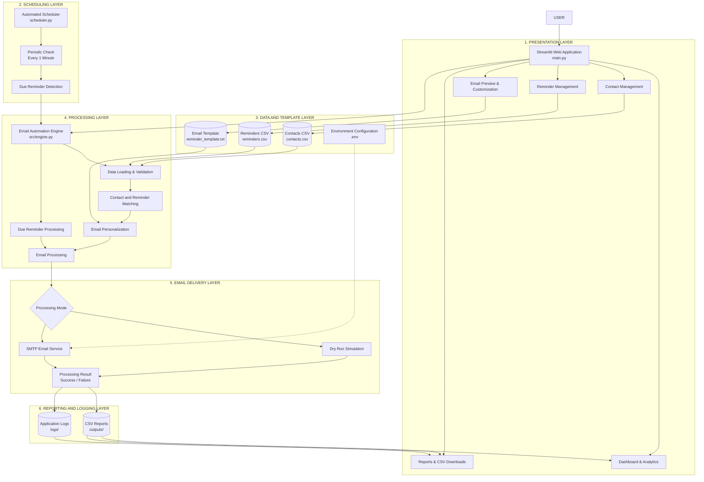

# Remindly – Email Automation & Reminder System

An automated email reminder management system built using Python and Streamlit. Remindly helps users manage contacts, schedule reminders, generate personalized email messages, preview and customize emails, and process reminders through an automated scheduling engine.

The application provides a dashboard for monitoring reminder activity, simulation analytics, processing history, and downloadable CSV reports.

---

## 1. Project Overview

Remindly is designed to simplify repetitive email reminder tasks by automating the process of preparing, scheduling, and processing reminder emails.

Instead of manually composing and sending individual reminder emails, users can manage contact information and reminder schedules through CSV files and interact with them using a Streamlit-based web interface.

The system supports a safe Dry Run mode, allowing users to test email processing without sending actual emails.

### Project Objectives

- Automate repetitive email reminder tasks.
- Manage contacts and reminder records efficiently.
- Generate personalized email content using templates.
- Allow users to preview and customize emails before processing.
- Schedule automatic checks for due reminders.
- Support email processing through SMTP.
- Maintain processing logs and CSV reports.
- Provide analytics through an interactive dashboard.

---

## 2. Features and Functionality

### 2.1 Interactive Dashboard
- Displays total contacts and reminder statistics.
- Provides an overview of reminder statuses.
- Shows department-wise and status-wise analytics.
- Allows users to simulate reminder processing.

### 2.2 Contact Management
- Loads contact information from CSV files.
- Displays contact names, email addresses, and departments.
- Supports contact searching and department filtering.
- Allows contact data export.

### 2.3 Reminder Management
- Loads reminder records from CSV files.
- Displays reminder titles, dates, times, and statuses.
- Supports reminder searching and status filtering.
- Allows reminder data export.

### 2.4 Email Template Personalization
- Uses a reusable email template.
- Automatically inserts contact names and reminder details.
- Generates personalized email subjects and messages.

### 2.5 Email Preview and Customization
- Displays the generated email before processing.
- Allows users to edit the email subject.
- Allows users to customize the email message.
- Provides a live email preview.
- Supports resetting the message to its original template.
- Processes customized emails in Dry Run mode.

### 2.6 Automated Reminder Scheduler
- Checks for due reminders automatically.
- Runs periodic checks using the Schedule library.
- Processes reminders based on their scheduled date and time.
- Prevents repeated processing of the same reminder during a scheduler session.
- Supports safe Dry Run processing.

### 2.7 Email Processing
- Supports simulated email processing.
- Provides SMTP-based email sending functionality.
- Records successful and failed processing results.
- Keeps real email sending disabled in the default Dry Run workflow.

### 2.8 Reports and Analytics
- Displays total processed reminders.
- Shows successful and failed processing counts.
- Calculates processing success rate.
- Maintains timestamped CSV reports.
- Allows users to select and download reports.
- Displays automation logs.

---

## 3. Technologies Used

| Technology | Purpose |
|---|---|
| Python | Core programming language |
| Streamlit | Interactive web application |
| Pandas | CSV processing and data analysis |
| Schedule | Automated periodic scheduling |
| SMTP | Email delivery |
| Python-dotenv | Environment variable management |
| Logging | Application and scheduler logs |
| HTML and CSS | Email preview styling |
| Git and GitHub | Version control and project hosting |

---

## 4. Project Architecture


Remindly follows a modular architecture in which the user interface, processing engine, scheduler, data storage, and reporting components work together.

### 4.1 Complete System Architecture – Block Diagram



### 4.2 Architecture Layers

| Layer | Component | Responsibility |
|---|---|---|
| Presentation | main.py | User interface |
| Scheduling | scheduler.py | Due reminder checks |
| Data and Templates | data/, templates/ | Data storage |
| Processing | src/engine.py | Core processing |
| Email Delivery | Dry Run / SMTP | Email delivery |
| Reporting | outputs/, logs/ | Reports and logs |

### 4.3 Complete System Workflow

1. User interacts with the Streamlit dashboard.
2. Contact and reminder data is loaded from CSV files.
3. Personalized email messages are generated using templates.
4. Users preview and customize email content.
5. The processing engine handles email requests.
6. The scheduler independently checks for due reminders every minute.
7. The engine processes reminders in the selected mode.
8. Results are stored in CSV reports and application logs.
9. The dashboard displays processing history and analytics.


### 4.2 Component Description

**1. Presentation Layer – `main.py`**

The Streamlit application provides the graphical interface through which users interact with the system.

It includes:
- Dashboard
- Contacts
- Reminders
- Email Preview
- Reports

**2. Processing Layer – `src/engine.py`**

The engine handles the main business logic.

Its responsibilities include:
- Loading contacts and reminders.
- Loading email templates.
- Generating personalized messages.
- Processing email requests.
- Checking reminder dates and times.
- Processing due reminders.
- Generating CSV reports.
- Logging processing activities.

**3. Scheduling Layer – `scheduler.py`**

The scheduler runs independently of the Streamlit dashboard.

It:
- Performs an initial due-reminder check.
- Checks for due reminders every minute.
- Calls the processing engine.
- Maintains a session-level record of processed reminder IDs.
- Logs scheduler activity.

**4. Data Storage Layer – `data/`**

Stores contact and reminder information in CSV format.

**5. Template Layer – `templates/`**

Contains reusable email templates used to generate personalized reminder messages.

**6. Reporting and Logging Layer – `outputs/` and `logs/`**

Stores processing reports, simulation results, and application logs for monitoring and analysis.

### 4.3 Complete Processing Workflow

1. The user opens the Remindly dashboard.
2. Contact and reminder records are loaded from CSV files.
3. The system combines contact and reminder information.
4. Personalized email content is generated using the email template.
5. The user reviews and optionally edits the generated email.
6. The user processes the email in Dry Run mode or configures SMTP sending.
7. The scheduler independently checks for due reminders.
8. The processing engine handles eligible reminders.
9. Results are recorded in CSV reports.
10. Logs are maintained for monitoring.
11. The Reports section displays processing analytics and history.

---

## 5. Project Folder Structure

```text
email-automation-remainder-system/
│
├── data/
│   ├── contacts.csv
│   └── reminders.csv
│
├── templates/
│   └── reminder_template.txt
│
├── src/
│   └── engine.py
│
├── outputs/
│   └── Generated CSV reports
│
├── logs/
│   ├── automation.log
│   └── scheduler.log
│
├── images/
│   └── Application screenshots
│
├── docs/
│   └── Project documentation
│
├── main.py
├── scheduler.py
├── requirements.txt
├── README.md
├── .gitignore
└── .env.example
```

### Important Files

| File | Description |
|---|---|
| `main.py` | Streamlit dashboard and user interface |
| `scheduler.py` | Automated reminder scheduler |
| `src/engine.py` | Core processing engine |
| `data/contacts.csv` | Contact information |
| `data/reminders.csv` | Reminder information |
| `templates/reminder_template.txt` | Email message template |
| `requirements.txt` | Python dependencies |
| `.env.example` | SMTP configuration example |
| `.gitignore` | Files excluded from Git |

---

## 6. Installation and Execution

### Prerequisites

- Python 3.10 or later
- Visual Studio Code or another Python IDE
- Git (optional, for version control)

### Step 1: Clone the Repository

```bash
git clone YOUR_GITHUB_REPOSITORY_URL
```

Navigate to the project directory:

```bash
cd email-automation-remainder-system
```

### Step 2: Create a Virtual Environment

Windows:

```powershell
python -m venv .venv
```

Activate it:

```powershell
.venv\Scripts\Activate.ps1
```

### Step 3: Install Dependencies

```bash
pip install -r requirements.txt
```

### Step 4: Run the Streamlit Application

```bash
streamlit run main.py
```

The application will open in your browser, normally at:

```text
http://localhost:8501
```

### Step 5: Run the Automated Scheduler

Open another terminal, activate the same virtual environment, and execute:

```bash
python scheduler.py
```

The scheduler checks for due reminders every minute.

Press `Ctrl + C` to stop the scheduler safely.

---

## 7. Dry Run and SMTP Configuration

### 7.1 Dry Run Mode

Dry Run mode allows users to test the email automation workflow without delivering actual emails.

In this mode:
- Email content is generated normally.
- Email processing is simulated.
- Processing results are recorded.
- CSV reports are generated.
- Automation logs are maintained.
- No actual email is sent.

Dry Run is the default mode used by the dashboard simulation and scheduler.

### 7.2 SMTP Configuration

The system also supports actual email delivery through SMTP.

For Gmail SMTP:

1. Enable 2-Step Verification on your Google account.
2. Generate a Google App Password.
3. Configure the SMTP credentials using environment variables.
4. Set the application's processing mode to real sending only after testing.

Example `.env` configuration (use the exact variable names expected by `src/engine.py`):

```env
SMTP_HOST=smtp.gmail.com
SMTP_PORT=587
SMTP_USERNAME=your_email@gmail.com
SMTP_PASSWORD=your_google_app_password
```

**Security:** Never upload your `.env` file or real email credentials to GitHub. Use `.env.example` with placeholder values instead.

---

## 8. Application Screenshots

Add screenshots of the completed application inside the `images/` directory.

Suggested screenshots:

| Screenshot | Description |
|---|---|
| `dashboard.png` | Main dashboard and analytics |
| `contacts.png` | Contact management page |
| `reminders.png` | Reminder management page |
| `email-preview.png` | Email preview and customization |
| `reports.png` | Reports and simulation analytics |

Display them in the README using:

```markdown


```

---

## 9. Future Enhancements

- Add user authentication and role-based access.
- Support additional email providers.
- Add recurring reminder functionality.
- Provide email delivery confirmation and tracking.
- Support Excel file imports and exports.
- Add advanced reminder filtering and search.
- Introduce database integration for larger datasets.
- Add deployment support for cloud hosting.

---

## 10. Learning Outcomes

This project demonstrates practical implementation of:

- Python application development.
- Modular programming and code organization.
- CSV-based data management.
- Data processing using Pandas.
- Email automation using SMTP.
- Task scheduling and automation.
- Streamlit dashboard development.
- Logging and error handling.
- Report generation and analytics.
- Environment variable management.
- Version control using Git and GitHub.

---

## 11. Conclusion

Remindly provides an integrated solution for managing and automating email reminders. By combining personalized email templates, automated scheduling, email preview and customization, simulated processing, SMTP support, and reporting analytics, the system reduces repetitive manual work and provides a structured reminder management workflow.

---

## Author

**Project:** Remindly – Email Automation & Reminder System

**Developed using:** Python, Streamlit, Pandas, Schedule, and SMTP.
